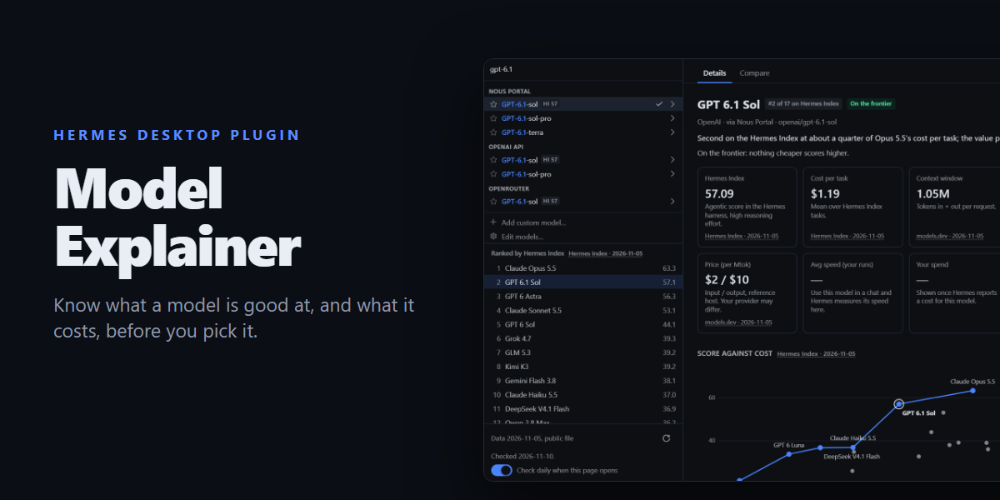
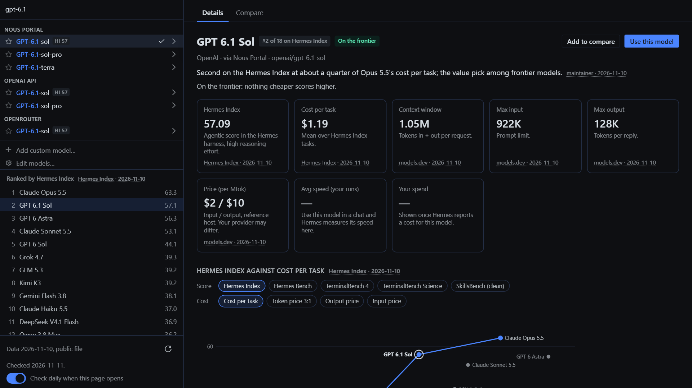
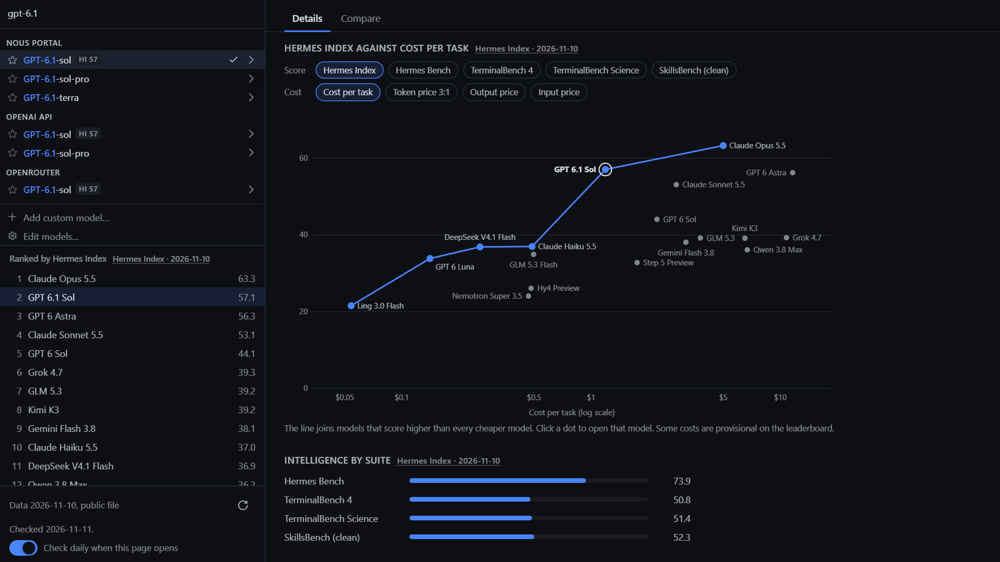
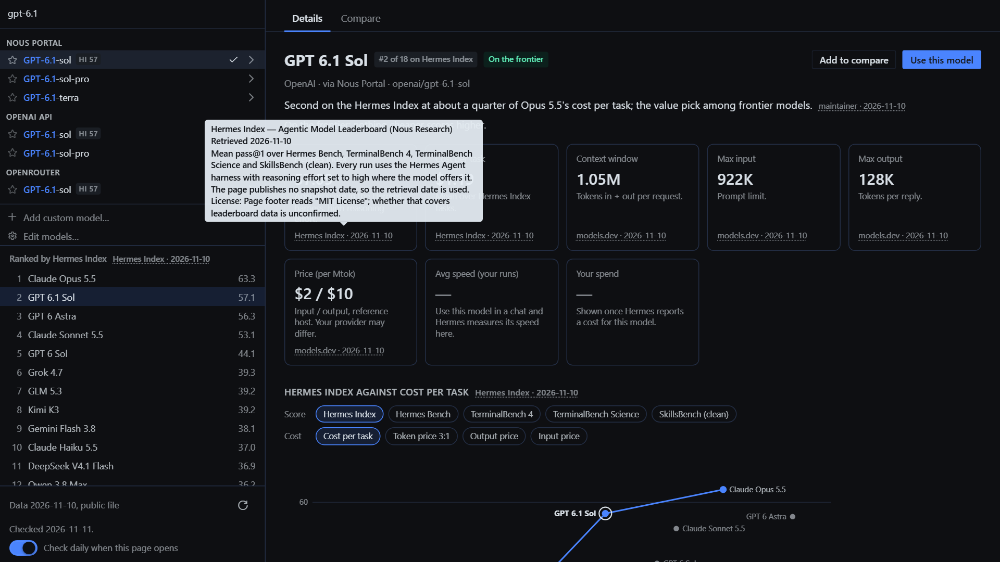
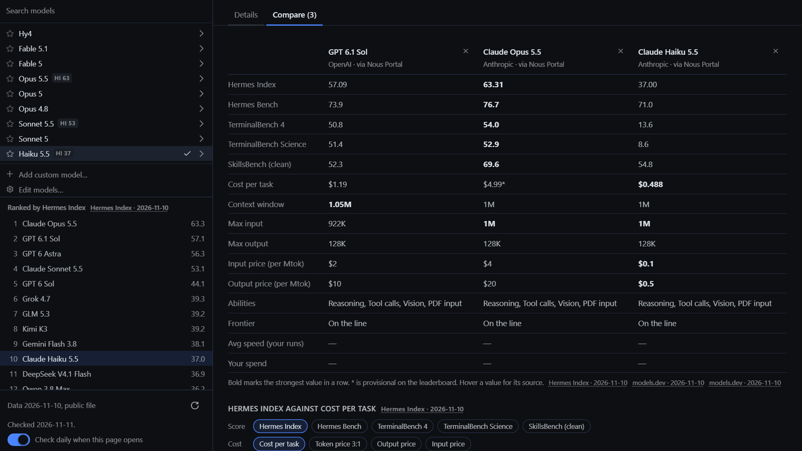

# Model Explainer for Hermes Desktop



A **Models** page for Hermes Desktop built around your real model picker. The left
column is Hermes' own menu, so provider sections, names, `-fast` grouping, favorites
and your Edit Models shortlist are exactly what the composer shows. Choosing a row
explains that model, and **Use this model** switches your chat to it:

- **Hermes Index** score and rank, with the per-suite breakdown (Hermes Bench,
  TerminalBench 4, TerminalBench Science, SkillsBench)
- **Cost per task** on the Hermes Index
- A **score-against-cost frontier chart**: every indexed model plotted and named, with the
  Pareto line joining models that score higher than everything cheaper. Switch the
  score (Hermes Index or any one suite) and the cost (cost per task, input price,
  output price, or a 3:1 blended token price) to see a different frontier. Each
  model says whether it is on the line and, if not, which model beats it. Click
  a dot to open that model.
- **Context window, max input, max output**
- **Price** per million tokens (reference host), plus the price Hermes reports
  for the provider you picked, when Hermes has it
- **Abilities** (reasoning, tool calls, vision, PDF, audio, video, fast mode)
- **Your measured speed and spend**: average tokens per second and cost, taken
  from Hermes' own usage stream while you chat. Nothing is estimated.
- A **one-line explanation** for each model
- A **ranking** of every scored model beside the picker; click one to open it
- **Compare** up to four models side by side, with the strongest value in each row
  marked and all four highlighted on the frontier chart
- A **performance-by-reasoning-effort chart**, shown only for models whose data
  includes a sourced curve (none do yet; see [Data](#data))

Every value shows its source and date. Hover a source to read it, click it to open
the page it came from. Figures measured on your machine are dated by your last run.

The picker also gets a small `HI 63` badge on rows that have a Hermes Index
score. The badge goes through the Desktop SDK's model-menu decoration slot, so
the picker itself is untouched.

| | |
|---|---|
|  |  |
|  |  |

Screenshots show the plugin page on its own, with a sample provider list.

Open it from the sidebar (**Models**) or ⌘K → **Model Explainer: Open** /
**Explain current model**.

## What it touches (disclosure)

| | |
|---|---|
| Network | **One GET of [`data/models.json`](data/models.json) from `raw.githubusercontent.com`**, at most once a day and only when you open the page, plus the check button. It sends no cookies, no referrer and nothing about you or your models; GitHub sees your IP address, as with any download. Turn it off with **Check daily when this page opens**. The bundled copy keeps working offline. |
| Reads | `model.options`, through Hermes' own picker component, and the focused session's model, profile and usage figures (`host.state.model`, `focusedSessionId`, `focusedSessionProfile`, `focusedUsage`). |
| Writes | Your chat model, only when you press **Use this model**: it sends the same `config.set model` request as Hermes' own picker, scoped to the open chat (`--session`) so your default is left alone, and a guarded switch asks through Hermes' confirm dialog. Otherwise plugin storage only (`ctx.storage`, namespace `hermes.plugin.model-explainer.*`): your measured speed/spend per model (capped at 40 sessions × 200 models), the latest valid data file, when it was last checked, the daily-check switch and your compare list. Stars, the Edit Models shortlist and collapsed sections are Hermes' own picker settings, so changing them here changes them in the composer too. |
| Background work | One listener on the usage stream; storage is saved at most every 5 seconds while you chat. While the page is open, Hermes' picker re-reads prices the way it does in the composer (a few times over about 10 seconds, only while they are warming). Nothing else runs in the background. |
| Costs | None from the plugin: it makes no model calls. A model you switch to is billed by its provider as usual. |
| Credentials | None read or stored. |
| Agent side | None: no tools, hooks, middleware, slash commands or env vars. |

Measured speed is Hermes' rolling average over recent calls, so the first
two calls after a model switch are not counted. It reflects whichever provider
you used for that model.

## Data

All model facts live in [`data/models.json`](data/models.json), which is plain
data checked against [`data/schema.json`](data/schema.json). Each value has the
form `{ "v": <value>, "src": "<source id>" }`, and each source records a URL,
retrieval date, license note and caveats.

Current sources:

- **Hermes Index** ([portal.nousresearch.com/bench](https://portal.nousresearch.com/bench)):
  score, per-suite scores and cost per task. Every run is at high reasoning
  effort, so the index has no reasoning-level breakdown. The page has no
  snapshot date, so the retrieval date is used.
- **models.dev** ([models.dev](https://models.dev), MIT): context, input and
  output limits, price, abilities. Prices are for the named host; others differ.
- **Maintainer**: the one-line explanations, written from the values above.

Not used: Artificial Analysis (its terms forbid republishing) and OpenRouter
(its terms forbid scraping, and it lists resale prices).

**Models without data** are listed like any other, with whatever Hermes itself
reports, plus a button to suggest them.

### Reporting a correction

Use **Report a correction** on any model, or open a
[correction report](../../issues/new?template=correction.yml). Include a
public source link. Accepted corrections change `data/models.json` only, and
reach users the next time their daily check runs.

### Updating the data (maintainers)

```bash
# edit data/models.json, then:
node scripts/embed-data.mjs          # validates and embeds the data and validator into desktop/plugin.js
node scripts/embed-data.mjs --check  # what CI runs
```

Pushing `data/models.json` to `main` publishes it: installed copies pick it up
without a new plugin version. Re-embedding keeps the offline copy current for the
next release.

The downloaded file is data, never code. It is parsed with `JSON.parse`, checked
against the rules in [`scripts/validate-data.mjs`](scripts/validate-data.mjs) (the
same rules CI runs), and shown as plain text. A file that is invalid, too large or
older than the one in use is ignored and the last good copy stays. Source links must
be `https://`. The plugin never fetches or replaces its own code. The worst a bad
data commit can do is show wrong numbers or link to the wrong page, so review data
changes like any other.

## Install

```bash
hermes plugins install model-explainer
```

That name works once the catalog entry is merged. Until then, install from the repository:

```bash
hermes plugins install tuancookiez-hub/hermes-model-explainer
```

Then enable **Model Explainer** in Desktop → Capabilities → Plugins.

Requires Hermes ≥ 0.23.0.

## License

MIT. Data from models.dev is MIT (sst/models.dev). Hermes Index figures are
quoted with attribution to Nous Research.
